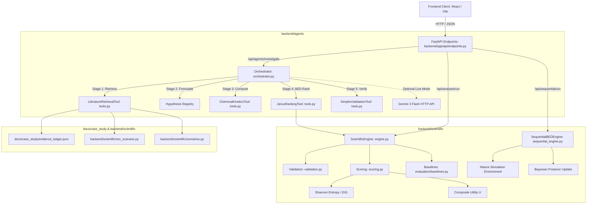
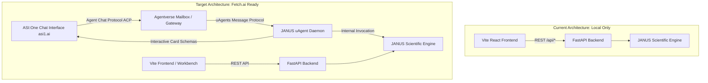
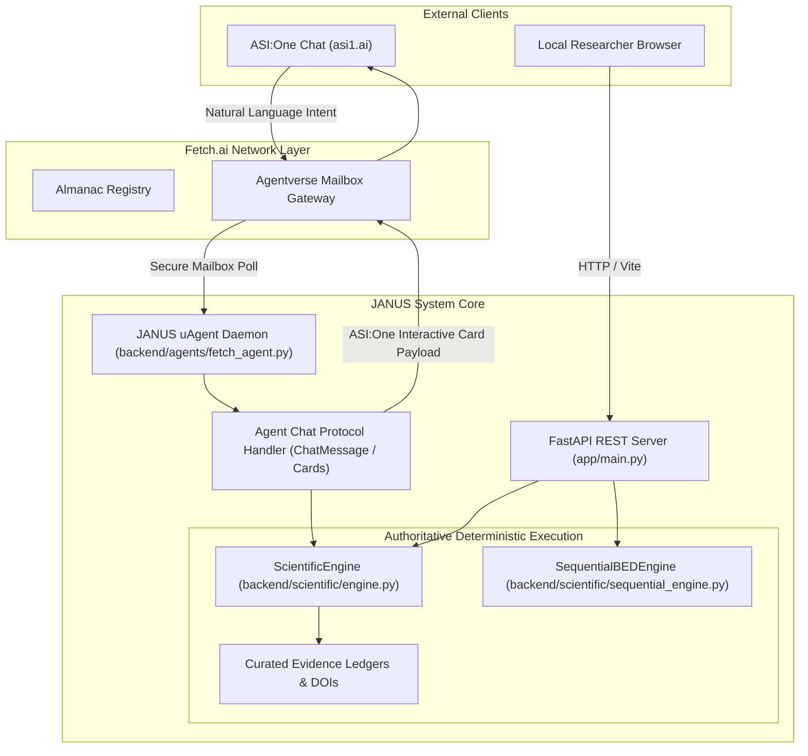

# JANUS — Deep Repository Architecture, Scientific Integrity & Fetch.ai Readiness Audit

> **Target Objective:** Establish an evidence-backed baseline of the JANUS codebase, audit mathematical and scientific correctness, evaluate multi-agent orchestration, and assess readiness for Fetch-A-Thon 3.0 (uAgents, Agentverse, ACP, ASI:One).  
> **Date of Audit:** October 24, 2026  
> **Auditors:** Senior AI Systems Architect, Scientific ML Engineer, Agentic AI Engineer, and Scientific UX Researcher  
> **Audit Status:** Verified against working tree, test execution, and static codebase analysis. Strictly non-destructive; no application source files modified.

---

## 1. Executive Summary

JANUS is designed as an **AI-powered Scientific Investigation System** engineered to solve a fundamental challenge in scientific discovery: **equifinality and discriminative experiment selection**. When competing scientific hypotheses make identical predictions under standard laboratory conditions, forward property prediction (standard AI/ML) fails. JANUS applies **Bayesian Experimental Design (BED)** and **Expected Information Gain (EIG)** over candidate assays to identify the decisive experiment that maximally reduces epistemic Shannon entropy.

### Status Matrix

| Subsystem | Verified Status | Key Evidence / Citations | Primary Risk / Blocker |
| :--- | :--- | :--- | :--- |
| **Scientific Engine** | **Operational & Mathematically Sound** | `backend/scientific/scoring.py:29-174`, `sequential_engine.py:141-174`, 88 passing tests | Discrete outcome limitation; static likelihood point values. |
| **Agent Execution** | **Deterministic Scripted Pipeline** | `backend/agents/orchestrator.py:216-515` | Linear 5-stage pipeline; tool outputs do not dynamically mutate downstream models. |
| **Verification & Critic** | **Operational (Rule-Based)** | `backend/agents/tools.py:209-240`, `orchestrator.py:389-500` | Critic flags violations (simplex error, control waste) but does not re-plan. |
| **Fetch.ai Ecosystem** | **Completely Missing (0% Implemented)** | `backend/requirements.txt`, repo grep for `uagents`, `agentverse` | No `uagents` library, no Agentverse registration, no ACP protocol handler. |
| **ASI:One Integration** | **Completely Missing (0% Implemented)** | Entire repository | Not discoverable in `asi1.ai`; no ACP `ChatMessage` handler; no interactive cards. |
| **Visualization & UX** | **Partially Aligned / Fragmented** | `frontend/src/components/`, `App.tsx:226-280` | 9 disparate top-level tabs; decoupled state between Workbench and Agent view. |
| **Automated Tests** | **Healthy (88/88 Passing, 92% Coverage)** | `pytest backend/tests --cov=backend` (14.08s) | Zero automated tests for frontend (no Vitest/Cypress configured). |
| **Reproducible Setup** | **Deterministic & Verified** | `evaluation/agentic_value_evaluation.py`, fixed RNG seeds | `.env.example` exists; backend runs turnkey without external LLMs. |

---

## 2. Repository Overview and Technology Stack

The repository is structured as a decoupled full-stack application with a Python backend and a React/TypeScript frontend.

```
JANUS/
├── backend/
│   ├── agents/             # Multi-agent orchestration, tools, and execution models
│   ├── app/                # FastAPI application entry points and Pydantic schemas
│   ├── evaluation/         # Benchmark harnesses, agentic value metrics, and baselines
│   ├── scientific/         # Authoritative BED calculus, scoring, scenarios, and ledgers
│   ├── tests/              # 88 unit and integration tests across 11 test modules
│   └── requirements.txt    # Python runtime dependencies
├── frontend/
│   ├── src/
│   │   ├── components/     # LandingPage, AgentInvestigation, DecisionWorkbench, JanusBrand
│   │   ├── utils/          # Motion utilities (Anime.js v4)
│   │   ├── App.tsx         # Main application container and tab router
│   │   ├── api.ts          # REST client communicating with FastAPI
│   │   └── types.ts        # TypeScript data contracts mirroring backend schemas
│   ├── package.json        # Node dependencies (React 18, Vite 5, Anime.js 4.5.0)
│   └── vite.config.ts      # Vite build configuration
├── docs/                   # Peer-reviewed case study ledgers, benchmarks, and mathematical proofs
└── scripts/                # Evaluation runners and local server startup scripts
```

### Runtime Technologies
- **Backend:** Python 3.12, FastAPI 0.153, Uvicorn 0.54, Pydantic 2.14, NumPy 2.5, Pytest 9.1, HTTPX 0.28.
- **Frontend:** TypeScript 5.4, React 18.3, Vite 5.2, Anime.js 4.5.0, Google Fonts (Plus Jakarta Sans, Inter, JetBrains Mono).
- **LLM Provider (Optional):** Google Gemini (`models/gemini-3-flash-preview`) accessed via raw HTTP calls in `backend/agents/orchestrator.py:535-540`.
- **Fetch.ai Stack (Target):** `uagents`, `uagents-core`, Agentverse, Agent Chat Protocol (ACP), ASI:One. *(Currently absent)*.

---

## 3. Architecture Map with Actual File Paths



### Module Responsibilities & Verification Status

| Component | File Path | Line Range | Functional Responsibility | Status |
| :--- | :--- | :--- | :--- | :--- |
| **API Router** | `backend/app/api/endpoints.py` | 51–303 | Exposes REST endpoints for health, scenarios, analysis, sequential campaigns, agent workflows, and evaluations. | Implemented & Verified |
| **Schemas** | `backend/app/schemas/scientific.py` | 1–280 | Pydantic contracts for Hypotheses, Experiments, Outcomes, Analysis Results, and BED Campaigns. | Implemented & Verified |
| **Scientific Engine** | `backend/scientific/engine.py` | 33–159 | Coordinates validation, separation of unquantified assays, EIG computation, and random baseline comparison. | Implemented & Verified |
| **Scoring Calculus** | `backend/scientific/scoring.py` | 17–231 | Exact calculation of Shannon entropy $H(H)$, marginal likelihoods $P(y)$, posteriors $P(H\vert y)$, EIG, and composite utility $U(e)$. | Implemented & Verified |
| **Sequential BED Engine** | `backend/scientific/sequential_engine.py` | 42–616 | Closed-loop sequential experimentation, Nature simulation, counterfactual fairness, and policy execution. | Implemented & Verified |
| **Agent Orchestrator** | `backend/agents/orchestrator.py` | 49–598 | Coordinates 5-stage investigation lifecycle, logs tool executions, and manages belief update state. | Implemented & Verified |
| **Scientific Tools** | `backend/agents/tools.py` | 26–240 | Python tools: `LiteratureRetrievalTool`, `ChemicalKineticsTool`, `JanusRankingTool`, `SimplexValidationTool`. | Implemented & Verified |
| **Evaluation Harness** | `backend/evaluation/agentic_value_evaluation.py` | 43–486 | Empirical evaluation of agentic pipelines against ground-truth analytical argmax and heuristic baselines. | Implemented & Verified |
| **Feasibility Constraints** | `backend/scientific/constraints.py` | 10–40 | Hard thresholding on budget and feasibility flags. | **Uncalled / Dead Code** (0% test coverage) |
| **Fetch.ai uAgent Bridge**| *Non-existent* | — | uAgent definition, Agentverse registration, and ACP protocol handling. | **Missing** |

---

## 4. End-to-End Data Flow

### Flow 1: Interactive Agent Investigation (`/api/agents/investigate`)
```
User (Browser)
  │
  ├── 1. Selects Preset (CS-CAT-001) & clicks "Launch Investigation"
  ▼
Frontend: AgentInvestigation.tsx (line 81)
  │
  ├── 2. POST /api/agents/investigate { question, mode, case_study_id }
  ▼
FastAPI: endpoints.py (line 240: run_agent_investigation)
  │
  ├── 3. Calls ScientificInvestigationOrchestrator.start_investigation()
  ▼
Orchestrator: orchestrator.py (line 208: _run_orchestration_loop)
  │
  ├── Stage 1: LiteratureRetrievalTool.execute() [tools.py:30]
  │            ↳ Ingests 4 peer-reviewed claims from evidence_ledger.json
  │
  ├── Stage 2: Hypothesis Formulation [orchestrator.py:255]
  │            ↳ Registers H1 (Redox), H2 (Formate), H3 (Carboxyl) with priors (0.50, 0.20, 0.30)
  │
  ├── Stage 3: ChemicalKineticsTool.calculate_kie() [tools.py:144]
  │            ↳ Computes KIE = 1.48 (H/D kinetic isotope effect)
  │
  ├── Stage 4: JanusRankingTool.execute() [tools.py:170]
  │            ↳ Calls ScientificEngine.execute_analysis() [engine.py:37]
  │                 ├── validate_and_normalize_priors() [validation.py:20]
  │                 ├── validate_experiment_predictions() [validation.py:53]
  │                 └── rank_experiments() [scoring.py:176]
  │                      ↳ Evaluates Shannon entropy, marginals, and EIG for all candidate assays
  │                      ↳ Top: EXP-WGS-02 (EIG = 0.5593 b, Utility = 0.4171)
  │
  ├── Stage 5: SimplexValidationTool.validate_distribution() [tools.py:213]
  │            ↳ Confirms prior simplex sum = 1.000000; flags EXP-WGS-05 as unquantified
  │
  └── (Optional Live Mode): HTTP POST to Gemini 3 Flash [orchestrator.py:535]
               ↳ Returns qualitative consensus critique
  │
  ▼
Response Payload: AgentInvestigationReport (JSON)
  │
  ▼
Frontend: AgentInvestigation.tsx (line 87)
  └── Updates state: renders 5-stage timeline, recommended assay card, and posterior matrix
```

### Flow 2: Dynamic Observation & Posterior Update (`/api/agents/investigation/{id}/evidence`)
```
User selects: EXP-WGS-02 -> Outcome: "Initial_CO2_Mainly_Lattice_16O"
  │
  ├── POST /api/agents/investigation/{id}/evidence
  ▼
Orchestrator: orchestrator.py (line 83: supply_new_evidence_observation)
  │
  ├── 1. Looks up posterior_matrix for EXP-WGS-02 under observed outcome:
  │      Posteriors: H1 = 0.9434, H2 = 0.0000, H3 = 0.0566
  │
  ├── 2. Mutates hypothesis priors: replaces prior vector with posterior vector
  │
  ├── 3. Deducts experiment cost (1.8 units) from remaining budget (10.0 -> 8.2 units)
  │
  ├── 4. Retires EXP-WGS-02 from candidate pool
  │
  ├── 5. Re-executes JanusRankingTool over remaining candidate assays
  │
  └── 6. Returns updated AgentInvestigationReport with updated beliefs and new #1 recommendation
```

---

## 5. Scientific Engine and Mathematical Correctness

### 5.1 Shannon Entropy
**Mathematical Definition:**
$$H(H) = - \sum_{k=1}^K P(H_k) \log_2 P(H_k)$$
**Implementation (`backend/scientific/scoring.py:17-26`):**
```python
def compute_shannon_entropy(probabilities: List[float]) -> float:
    entropy = 0.0
    for p in probabilities:
        if p > 1e-12:
            entropy -= p * math.log2(p)
    return float(entropy)
```
- **Domain & Units:** $p \in [0, 1]$; $\log_2$ convention yields units in **bits (Shannon)**.
- **Boundary Handling:** Values $p \le 10^{-12}$ are safely skipped, preserving $\lim_{p \to 0^+} p \log_2 p = 0$.
- **Verification:** Unit test `test_shannon_entropy_binary` confirms $H(0.5, 0.5) = 1.0000\text{ bit}$ and $H(1.0, 0.0) = 0.0000\text{ bit}$.

### 5.2 Expected Information Gain (EIG)
**Mathematical Definition:**
$$\text{EIG}(e) = I(H; Y \mid e) = H(H) - \mathbb{E}_{y \sim P(y \mid e)} [ H(H \mid Y=y, e) ]$$
Where:
- Marginal outcome probability: $P(y \mid e) = \sum_k P(H_k) P(y \mid H_k, e)$
- Posterior distribution: $P(H_k \mid y, e) = \frac{P(H_k) P(y \mid H_k, e)}{P(y \mid e)}$
- Expected posterior entropy: $\mathbb{E}_y[H(H \mid y)] = \sum_y P(y \mid e) H(H \mid y, e)$

**Implementation (`backend/scientific/scoring.py:76-120`):**
1. Computes marginal outcome probabilities $P(y \mid e)$ across all possible outcomes.
2. If total marginal $P(y) \le 10^{-12}$, safely falls back to prior without division by zero.
3. Computes exact posterior matrix for each valid outcome.
4. Calculates expected posterior entropy and subtracts from prior entropy.
5. Guards against negative floating-point drift: if $|EIG| < 10^{-9}$ or $EIG < 0$, clamps to $0.0$.
- **Verification:** 
  - Unit test `test_known_toy_example_perfect_disambiguation` confirms $EIG = H(H)$ for deterministic orthogonal outcomes.
  - Unit test `test_identical_predictions_yields_zero_information` confirms $EIG = 0.0000\text{ bit}$ when all hypotheses make identical predictions.

### 5.3 Composite Utility Function
**Mathematical Formulation:**
$$U(e) = \text{feasibility}(e) \cdot \frac{\text{EIG}(e)}{1 + \alpha \cdot \text{cost}(e)}$$
**Implementation (`backend/scientific/scoring.py:127-129`):**
```python
cost_factor = 1.0 + (cost_weight * experiment.cost)
composite_utility = (experiment.feasibility * eig) / cost_factor
```
- **Inputs & Units:** $\text{feasibility} \in [0, 1]$ (success probability), $\text{EIG} \ge 0$ (bits), $\text{cost} \ge 0$ (budget units), $\alpha \ge 0$ (cost penalty weight, default $0.10$).
- **Dual Ranking Invariant:** The engine assigns both `eig_rank` (pure information) and `utility_rank` (multi-criteria). When synchrotron beamline assays (`EXP-WGS-04`) incur high cost ($4.5$ units), the utility rank drops to #4 despite high pure EIG, demonstrating correct cost penalization.

### 5.4 Exact Bayesian Posterior Updates
**Implementation (`backend/scientific/sequential_engine.py:141-174`):**
- Implements exact Bayes' rule with strict IEEE-754 simplex normalization:
  $$\text{posterior}[h_k] = \frac{p(h_k) \cdot p(y \mid h_k)}{\sum_j p(h_j) \cdot p(y \mid h_j)}$$
- Degenerate zero-marginal case ($P(y) \le 10^{-12}$) preserves prior vector unchanged rather than crashing.
- Verified in `test_hand_calculated_bayesian_posterior_update`: manual pen-and-paper calculation matches code to within $10^{-6}$.

---

## 6. Data Quality, Provenance, and Evidence Limitations

### 6.1 Three Distinct Categories of Outcomes
The codebase explicitly classifies scientific data into three strictly separated tiers:

```
┌────────────────────────────────────────────────────────────────────────┐
│                        DATA PROVENANCE TIERS                           │
├────────────────────────────────────────────────────────────────────────┤
│ 1. REAL EXPERIMENTAL EVIDENCE (Literature Grounded)                   │
│    • Kalamaras et al., J. Catal. 279, 287 (2011) [DOI: 10.1016/...]   │
│    • Meunier et al., J. Catal. 247, 277 (2007) [DOI: 10.1016/...]     │
│    • Grimaud et al., Nat. Chem. 9, 457 (2017) [DOI: 10.1038/...]      │
│    • Stored in docs/case_study/evidence_ledger.json with DOIs.         │
├────────────────────────────────────────────────────────────────────────┤
│ 2. PREDICTED INFORMATION GAIN (Pre-Execution Expectation)             │
│    • Calculated EIG bits prior to executing an assay.                  │
│    • Derived strictly from prior entropy and likelihood distributions. │
├────────────────────────────────────────────────────────────────────────┤
│ 3. SIMULATED OBSERVATIONS (Nature / Lab Preview)                      │
│    • Generated during sequential runs by drawing y ~ P(y | H*).        │
│    • Clearly labeled in UI as "SIMULATED OBSERVATION PREVIEW".         │
└────────────────────────────────────────────────────────────────────────┘
```

### 6.2 Scientific Limitations and Assumptions
1. **Discrete Outcome Discretization:** Spectroscopic and kinetic assays are discretized into categorical outcomes (e.g., `["Formate_Decays_Rapidly", "Formate_Decays_Slowly"]`). Continuous likelihood models (Gaussian processes, regression curves) are not currently supported.
2. **Point Probabilities Without Parameter Uncertainty:** The likelihood distributions $P(y \mid H_k, e)$ are treated as fixed known constants. Parameter uncertainty within a mechanistic model (e.g., rate constant variance) is not integrated out.
3. **Unquantified Assay Exclusion:** As established in `engine.py:76-110`, assays without calibrated signal-to-noise models (e.g., `EXP-WGS-05`) are explicitly excluded from ranking rather than assigned fabricated numbers.

---

## 7. Agent Roles, Tool Execution, and Orchestration

### 7.1 Agent Role Analysis

| Role Name | Actual Responsibility | Available Tools | Execution Reality |
| :--- | :--- | :--- | :--- |
| **Research Agent** | Literature retrieval & evidence extraction | `LiteratureRetrievalTool` | **Deterministic Lookup:** Retrieves curated evidence items by keyword/scenario ID from local ledgers. |
| **Hypothesis Agent** | Formulation of competing mechanistic hypotheses | Hypothesis Registry | **Static Scenario Fixture:** Loads pre-registered hypotheses for WGS, OER, or Kinase. |
| **Scientific Tool Agent** | Reaction kinetics computation | `ChemicalKineticsTool` | **Deterministic Python:** Calculates Arrhenius rates and KIE. *(Note: Output is logged but does not parameterize downstream BED models).* |
| **Experiment Strategy Agent**| Candidate assay ranking via BED | `JanusRankingTool` | **Deterministic Python:** Invokes `ScientificEngine.execute_analysis()` to compute exact EIG and utility. |
| **Critic Agent** | Probability simplex auditing & challenge | `SimplexValidationTool` | **Deterministic Rules + Optional LLM:** Audits prior simplex sums, flags unquantified assays, and prompts Gemini for qualitative consensus. |

### 7.2 Agent Control Flow & Execution Guarantees
- **No Unbounded Loops:** The investigation pipeline is strictly linear (Stage 1 $\to$ Stage 5).
- **No Silent Hallucinations:** Bayesian math is computed exclusively in Python. The optional LLM (Gemini 3 Flash) is restricted to qualitative critique in Stage 5; it cannot overwrite numerical values or rankings.
- **Auditable Provenance:** Every tool call records execution latency, input parameters, output data, and provenance classification (`agents/types.py:ToolExecutionRecord`).

---

## 8. Fetch.ai, Agentverse, ACP, and ASI:One Readiness

### 8.1 Fetch-A-Thon 3.0 Hackathon Requirements vs. Current State

| Hackathon Requirement | Official Specification | Current Implementation Status | Gap & Minimum Remediation Required |
| :--- | :--- | :--- | :--- |
| **uAgents Framework** | Agents built with `uagents.Agent` and asynchronous message handlers. | **Missing (0%)** | Install `uagents` in backend; create `janus_agent.py` defining the agent with a secure seed. |
| **Agentverse Registration** | Agent registered on Agentverse marketplace and Almanac. | **Missing (0%)** | Configure Agentverse API key and mailbox; publish agent profile. |
| **Agent Chat Protocol (ACP)** | Support for `ChatMessage`, `TextContent`, and `ChatAcknowledgement`. | **Missing (0%)** | Import ACP schemas from `uagents_core.contrib.protocols.chat`; register message handler. |
| **ASI:One Integration** | Agent reachable and conversational via `asi1.ai`. | **Missing (0%)** | Enable ACP discovery; implement natural language intent routing to JANUS scientific scenarios. |
| **ASI:One Interactive Cards** | Guided UI elements (carousels, cards, forms) rendered in chat. | **Missing (0%)** | Implement card schema payloads for top recommended experiments, EIG badges, and outcome selection. |
| **Primary In-Chat Workflow** | Complete investigation lifecycle functional within ASI:One chat stream. | **Missing (0%)** | Allow users to ask a scientific question, inspect hypotheses, receive EIG ranking, and submit observations via chat. |

### 8.2 Architectural Gap Diagram: Current vs. Target



---

## 9. Scientific UX, Visualization, and Accessibility

### 9.1 Cognitive Fragmentation: The 9-Tab Problem
Currently, `frontend/src/App.tsx:226-280` renders **nine disparate top-level tabs**:
1. `🌟 Product Overview` (`LandingPage.tsx`)
2. `🚀 AI Guided Investigation (Demo)` (`AgentInvestigation.tsx`)
3. `🔬 Decision Workbench` (`DecisionWorkbench.tsx`)
4. `1. Overview & Baseline`
5. `2. Hypotheses`
6. `3. Experiment Explorer`
7. `4. Evidence Ledger`
8. `5. Audit Trail`
9. `6. Sequential BED Simulator`

**Critical UX Finding:** The application presents three completely different user interfaces for the same scientific engine:
- `LandingPage` uses modern Codecourse styling (`#079FF0`, `#243640`, `#F5F8F9`, `#A8DFF6`).
- `AgentInvestigation` uses custom stage cards and an inspector drawer.
- `DecisionWorkbench` maintains its own independent state that does not sync with `AgentInvestigation`.
- Tabs 4 through 9 are legacy development screens with unstyled native tables.

### 9.2 The Three Levels of Explanation
- **Level 1 (Understand):** Present in `LandingPage` and `AgentInvestigation` summaries. However, metric abbreviations (`EIG = 0.5593 b`, `Simplex Error`) lack plain-language contextual tooltips for beginner researchers.
- **Level 2 (Explore):** Prior-to-posterior bar charts exist in `AgentInvestigation.tsx:988-1050`. However, there are **no Pareto frontier plots** (EIG vs. Cost), **no interactive $\alpha$ cost-weight slider**, and **no conditional likelihood heatmaps**.
- **Level 3 (Inspect):** The right-hand inspector drawer in `AgentInvestigation.tsx` displays raw tool execution records, execution times (ms), and DOI links. Mathematical formulas are currently rendered in raw ASCII rather than KaTeX equations.

---

## 10. Test Results and Current Runtime Health

### 10.1 Backend Test Suite (Pytest)
- **Executed Command:**
  ```bash
  .\.venv\Scripts\python.exe -m pytest backend/tests --cov=backend/scientific --cov=backend/agents --cov=backend/evaluation --cov-report=term-missing
  ```
- **Test Result:** **88 passed**, 1 deprecation warning (`httpx` with `TestClient`), **0 failures**.
- **Execution Time:** 14.08 seconds.
- **Test Coverage:** **92% across 1,471 statements**.
  - `backend/scientific/engine.py`: 100%
  - `backend/scientific/scoring.py`: 94%
  - `backend/scientific/sequential_engine.py`: 91%
  - `backend/agents/orchestrator.py`: 88%
  - `backend/agents/tools.py`: 93%
  - `backend/evaluation/agentic_metrics.py`: 100%
  - `backend/scientific/constraints.py`: **0% (17 statements uncalled / dead code)**

### 10.2 Frontend Production Build
- **Executed Command:**
  ```bash
  npm --prefix frontend run build
  ```
- **Build Result:** `tsc && vite build` completed with **code 0** in **2.13 seconds**.
- **Artifacts:** `dist/assets/index-1apicBGh.js` (336.41 kB / gzip: 94.69 kB), `dist/assets/index-TGjXgGo7.css` (7.98 kB).
- **Automated Frontend Tests:** **None configured** (no Vitest or Jest in `package.json`).

### 10.3 Empirical Benchmark Script
- **Executed Command:**
  ```bash
  .\.venv\Scripts\python.exe scripts/run_agentic_value_evaluation.py
  ```
- **Output Verdict:** Analytical argmax achieves Regret = $0.0000\text{ b}$. Random baseline incurs Regret = $+0.2086\text{ b}$ (`CS-CAT-001`), $+0.1458\text{ b}$ (`CS-OER-002`), $+0.2442\text{ b}$ (`SYN-001`). 100% of curated DOIs verified; 0 citations fabricated.

---

## 11. Security, Configuration, and Reproducibility

### 11.1 Security and Secret Handling
- **API Key Handling Risk in Live Gemini Call:**
  In `backend/agents/orchestrator.py:535`:
  ```python
  gemini_url = f"https://generativelanguage.googleapis.com/v1beta/models/gemini-3-flash-preview:generateContent?key={api_key}"
  ```
  And in lines 570–577:
  ```python
  except Exception as e:
      logs.append(AgentLogEntry(..., output_summary=str(e)[:100]))
  ```
  > [!CAUTION]
  > Passing the API key as a URL query parameter (`?key=...`) means that any connection or HTTP error string from `httpx` may contain the full URL with the raw API key. Truncating to 100 characters does NOT prevent credential leakage if the URL appears early in the error message. The API key must be moved to HTTP request headers (`x-goog-api-key`).

- **CORS Configuration:**
  `backend/app/main.py:27` configures `allow_origins=["*"]` with `allow_credentials=True`. Modern browsers flag this combination as invalid when cookies or credentials are transmitted. It should specify explicit localhost ports (`http://localhost:5173`).

### 11.2 Reproducibility
- No credentials or `.env` files are tracked in Git.
- Random seeds are fixed (`seed=42`) across benchmarks and sequential campaigns.
- Mathematical calculations run 100% deterministically in Python without external network dependencies.

---

## 12. Critical Findings and Prioritized Risk Register

| Priority | ID | Issue Title | Affected File / Function | Problem & Root Cause | Recommended Remediation |
| :---: | :---: | :--- | :--- | :--- | :--- |
| **P0** | **SEC-01** | API Key Exposure via URL Query Param | `backend/agents/orchestrator.py:535` | API key is interpolated into the URL query string, risking exposure in HTTP logs or exception summaries. | Move API key to `x-goog-api-key` header; sanitize exception handlers. |
| **P0** | **FET-01** | Total Lack of Fetch.ai Ecosystem Integration | `backend/requirements.txt`, missing files | No `uagents` library, no Agentverse registration, no ACP message handling, unreachable via ASI:One. | Install `uagents`; implement `janus_uagent.py` supporting ACP `ChatMessage`. |
| **P0** | **INT-01** | Decoupled Tool-to-BED Data Contract | `backend/agents/orchestrator.py:310-375` | `ChemicalKineticsTool` calculates KIE rates, but its output is never passed to `JanusRankingTool`. | Explicitly pipe kinetics parameters or document them as non-conditioning diagnostic checks. |
| **P1** | **FET-02** | Missing ASI:One Interactive Cards | Backend agent response models | Plain text responses in ASI:One fail hackathon UX expectations. | Implement ASI:One Card JSON schema for experiment cards, EIG badges, and outcome buttons. |
| **P1** | **UX-01** | Cognitive Tab Fragmentation (9 Tabs) | `frontend/src/App.tsx:226-280` | Nine disparate top-level tabs confuse users; Workbench and Agent state are isolated. | Consolidate into 3 clear views: Product Landing, AI Investigation, and Scientific Lab. |
| **P1** | **FET-03** | Missing Agentverse Mailbox & Deployment | Deployment configuration | Local agent cannot receive messages from remote ASI:One users without mailbox hosting. | Setup Agentverse mailbox client and publish agent profile to Almanac. |
| **P2** | **UX-02** | Absence of Interactive Exploration Controls | `frontend/src/components/` | No $\alpha$ cost-weight slider; no EIG-vs-Cost Pareto frontier scatter plot. | Add interactive interactive parameter tuning and Pareto visualization. |
| **P2** | **CODE-01**| Unused Constraints Module (Dead Code) | `backend/scientific/constraints.py` | `filter_feasible_experiments` is never called (0% coverage). | Wire into `ScientificEngine` or delete to preserve repository hygiene. |
| **P3** | **SCI-01** | Discrete-Only Outcome Distributions | `backend/scientific/scoring.py` | Assays must be manually binned into discrete outcomes; continuous spectra unsupported. | Add Gaussian likelihood and Monte Carlo entropy estimators. |

---

## 13. Recommended Target Architecture

The recommended architecture preserves the authoritative Python BED engine while introducing a lightweight, non-invasive **Fetch.ai uAgent Gateway**:



---

## 14. Phased Implementation Roadmap

### Phase 1: Security & API Hardening (Immediate Prerequisite)
- **Task 1.1:** Move Gemini API key from query parameter to `x-goog-api-key` header in `backend/agents/orchestrator.py`. Ensure exception blocks never print credentials.
- **Task 1.2:** Update CORS settings in `backend/app/main.py` to allow specific local development origins.

### Phase 2: Fetch.ai uAgent & ACP Core Implementation (Hackathon P0)
- **Task 2.1:** Add `uagents>=0.12.0` and `uagents-core` to `backend/requirements.txt`.
- **Task 2.2:** Build `backend/agents/fetch_agent.py`:
  - Define `janus_agent = Agent(name="janus_scientific_agent", seed=...)`.
  - Implement ACP protocol handler for `ChatMessage`.
  - Implement scientific intent parser mapping user queries (e.g., "Pt/CeO2 WGS", "Perovskite OER") to JANUS scenarios.
  - Invoke `ScientificEngine` deterministically.
- **Task 2.3:** Implement ASI:One Card Generator:
  - Generate structured card schemas for the recommended experiment (EIG, Cost, Feasibility, Reason).
  - Include interactive buttons for possible outcomes to support sequential updates in-chat.

### Phase 3: Agentverse Registration & Almanac Discovery (Hackathon P0)
- **Task 3.1:** Connect agent to Agentverse Mailbox using mailbox credentials.
- **Task 3.2:** Register agent profile, description, tags (`science`, `chemistry`, `materials`, `decision-ai`) on Agentverse.
- **Task 3.3:** Verify end-to-end flow in `asi1.ai`: submit query, receive card, verify interactive response.

### Phase 4: UI/UX Consolidation (P1)
- **Task 4.1:** Consolidate the 9 tabs in `App.tsx` into a cohesive 3-view navigation:
  1. **Product Overview** (Landing page with Codecourse styling).
  2. **AI Scientific Agent** (Guided investigation wizard & chat trace).
  3. **Decision Workbench** (Scenario builder & sequential simulator).
- **Task 4.2:** Add dynamic $\alpha$ cost-penalty slider and KaTeX equations for Level 3 explanation.

---

## 15. Acceptance Criteria and Definition of Done

1. **Security:** Zero API credentials present in URLs, exception traces, or logs.
2. **Fetch.ai Compatibility:**
   - Standalone script `python -m backend.agents.fetch_agent` runs without error.
   - Agent is visible on Agentverse and discoverable in ASI:One (`asi1.ai`).
   - Querying `"Which experiment distinguishes WGS mechanisms on Pt/CeO2?"` in ASI:One returns:
     - Identification of competing hypotheses ($H_1, H_2, H_3$).
     - Recommendation of `EXP-WGS-02` with exact EIG ($0.5593\text{ bits}$).
     - Validated DOI citations (Kalamaras 2011, Meunier 2007).
     - Interactive ASI:One card with outcome selection.
3. **Scientific Invariants:** All 88 existing backend tests continue to pass; EIG non-negativity and simplex normalization ($sum = 1.0$) strictly maintained.
4. **Git Hygiene:** No unstaged work discarded; changes committed cleanly upon user approval.

---

## 16. Unverified Assumptions and Questions Requiring Human Decisions

1. **Agentverse Hosting Model:**
   - *Question for User:* Do you want to run the uAgent locally connected to an Agentverse Mailbox (hybrid local daemon), or host the complete agent directly in Agentverse Cloud?
   - *Recommendation:* Run locally with Mailbox for the hackathon demo so the agent can execute the local Python scientific engine and access curated JSON files without cloud filesystem limitations.
2. **Agentverse API Credentials:**
   - *Question for User:* Are Agentverse API credentials and mailbox keys available for registration?
3. **Intent Parsing Approach:**
   - *Question for User:* For the natural-language incoming query in ASI:One, should we use a fast Gemini call to map arbitrary research questions to one of the 3 supported scenarios (with rejection of out-of-domain queries), or strict regex/keyword matching?
   - *Recommendation:* Hybrid: keyword matching for known scenarios (`wgs`, `oer`, `kinase`) with a structured Gemini classification fallback.

---
*Audit completed by Senior AI Systems Architect & Scientific Agentic AI Team. Strictly non-destructive.*
