# JANUS Case Study Specification: Mechanism of the Alkaline Oxygen Evolution Reaction on Perovskite Electrocatalysts

**Case Study ID:** `CS-OER-002`  
**System:** Transition-Metal Perovskite Electrocatalysis ($\text{La}_{1-x}\text{Sr}_x\text{CoO}_{3-\delta}$ / $\text{SrCoO}_{2.7}$)  
**Domain:** Electrocatalysis / Water Splitting / Physical Inorganic Chemistry  
**Document Status:** Preregistered Proposal & Specification (Simulation Benchmark Design Only)  
**Protocol Version:** 1.0.0  

---

## 1. Central Scientific Question

> **By what chemical mechanism does the alkaline Oxygen Evolution Reaction ($4\text{OH}^- \rightarrow \text{O}_2 + 2\text{H}_2\text{O} + 4e^-$) proceed on cobaltite perovskite oxides ($\text{La}_{1-x}\text{Sr}_x\text{CoO}_{3-\delta}$), and how can sequential experimental interventions resolve competing catalytic pathways under real-world measurement uncertainties?**

Specifically, the scientific debate addresses whether $\text{O–O}$ bond formation and charge transfer are governed by:
1. **The Classical Adsorbate Evolution Mechanism (AEM):** Sequential proton-coupled electron transfers occurring solely on transition-metal surface cations ($\text{Co}$), with lattice oxygen acting strictly as a spectator framework.
2. **The Lattice Oxygen-Mediated Mechanism (LOM):** Direct chemical participation of lattice oxygen anions ($O_{\text{lat}}^{2-}$ / ligand holes $\text{O}^{\bullet-}$), leading to surface/subsurface oxygen vacancy creation ($V_{\text{O}}^{\bullet\bullet}$) and subsequent lattice refilling or surface amorphization.
3. **The Oxide Path / Direct Surface Radical Coupling Mechanism (OPM):** Non-concerted direct chemical coupling of adjacent electrophilic surface oxo/oxyl radicals ($\ast\text{O}^{\bullet} + \ast\text{O}^{\bullet} \rightarrow \text{O}_2$) without extracting bulk lattice oxygen into the gas phase.

---

## 2. Scientific Context & Epistemological Landscape

### 2.1 Catalytic Significance
Electrochemical water oxidation (OER) is the rate-limiting anode half-reaction for green hydrogen production via water electrolysis. Cobalt-based perovskite oxides ($\text{ABO}_3$), such as strontium-substituted lanthanum cobaltite ($\text{La}_{1-x}\text{Sr}_x\text{CoO}_{3-\delta}$), exhibit some of the highest recorded specific activities among earth-abundant catalysts in alkaline electrolytes.

However, understanding the atomistic origin of this high catalytic activity remains deeply contentious:
- **Scaling Limit of AEM:** For conventional AEM on transition-metal cations, universal linear scaling relations between the adsorption free energies of $\ast\text{OH}$ and $\ast\text{OOH}$ ($\Delta G_{\ast\text{OOH}} - \Delta G_{\ast\text{OH}} \approx 3.2 \pm 0.2\text{ eV}$) impose a theoretical minimum overpotential of $\eta \ge 0.37 - 0.40\text{ V}$.
- **Covalency & Ligand Hole Formation:** Doping $\text{Sr}^{2+}$ for $\text{La}^{3+}$ increases the formal oxidation state of cobalt toward $\text{Co}^{4+}$ and drastically enhances $\text{Co } 3d\text{ -- O } 2p$ covalency. As the O $2p$-band center shifts toward the Fermi level, holes appear on the oxygen ligand network, activating lattice oxygen redox.
- **Activity vs. Stability Dilemma:** While LOM bypasses the AEM scaling barrier, the creation of oxygen vacancies often triggers structural degradation, cation leaching, surface amorphization, and rapid activity decay. Conversely, the Oxide Path Mechanism (OPM) has been proposed as an alternative route to circumvent scaling without incurring bulk lattice dissolution.

---

## 3. Competing Hypotheses & Reaction Coordinate Formulations

To prevent artificial oversimplification, the hypotheses are formulated with explicit recognition that **mechanisms in real electrocatalysts may not be universally mutually exclusive**. A catalyst may exhibit potential-dependent transitions, concurrent mixed pathways, or dynamic surface restructuring under sustained anodic polarization.

```mermaid
flowchart TD
    subgraph H1["Hypothesis H1: Adsorbate Evolution Mechanism (AEM)"]
        A1["* + OH- -> *OH + e-"] --> A2["*OH + OH- -> *O + H2O + e-"]
        A2 --> A3["*O + OH- -> *OOH + e- (Scaling Bottleneck)"]
        A3 --> A4["*OOH + OH- -> * + O2 + H2O + e-"]
    end

    subgraph H2["Hypothesis H2: Lattice Oxygen-Mediated Mechanism (LOM)"]
        L1["* + OH- -> *OH + e-"] --> L2["*OH + O(lat) -> *O-O(lat) + H+ + 2e-"]
        L2 --> L3["*O-O(lat) -> * + O2 + V(O) (Vacancy Formation)"]
        L3 --> L4["V(O) Refilling vs. Cation Leaching / Amorphization"]
    end

    subgraph H3["Hypothesis H3: Oxide Path / Direct Radical Coupling (OPM)"]
        O1["2* + 2OH- -> 2*OH + 2e-"] --> O2["2*OH -> 2*O(radical) + 2H+ + 2e-"]
        O2 --> O3["*O(radical) + *O(radical) -> 2* + O2 (Direct Coupling)"]
        O3 --> O4["Bypasses *OOH without Bulk Vacancy Extraction"]
    end
```



### 3.1 Hypothesis 1 ($H_1$): Adsorbate Evolution Mechanism (AEM)
- **Chemical Formalism:** Four sequential concerted proton-electron transfers (CPET) on localized cobalt active sites:
  1. $\text{Co} + \text{OH}^- \rightarrow \text{Co-OH} + e^-$
  2. $\text{Co-OH} + \text{OH}^- \rightarrow \text{Co-O} + \text{H}_2\text{O} + e^-$
  3. $\text{Co-O} + \text{OH}^- \rightarrow \text{Co-OOH} + e^-$
  4. $\text{Co-OOH} + \text{OH}^- \rightarrow \text{Co} + \text{O}_2 + \text{H}_2\text{O} + e^-$
- **Governing Constraints:** Linear scaling relationship $\Delta G_{\ast\text{OOH}} = \Delta G_{\ast\text{OH}} + 3.2\text{ eV}$.
- **Predicted Characteristics:**
  - Concerted CPET yields ideal Nernstian behavior: $0\text{ mV/pH}$ slope on the Reversible Hydrogen Electrode (RHE) scale ($\Delta E / \Delta \text{pH}_{\text{RHE}} \approx 0$).
  - Evolved $\text{O}_2$ is derived from electrolyte $\text{H}_2\text{O}$ / $\text{OH}^-$.
  - Low intrinsic rate of steady-state cation dissolution; lattice framework remains intact.

### 3.2 Hypothesis 2 ($H_2$): Lattice Oxygen-Mediated Mechanism (LOM)
- **Chemical Formalism:** Direct participation of lattice oxygen anions ($O_{\text{lat}}$) in $\text{O–O}$ bond formation via ligand holes:
  1. Surface $\text{OH}^-$ adsorption accompanied by oxidation of adjacent lattice oxygen: $\text{Co-OH} + \text{O}_{\text{lat}} \rightarrow \text{Co} + \text{O-O}_{\text{lat}} + \text{H}^+ + 2e^-$
  2. $\text{O}_2$ desorption leaving a surface oxygen vacancy: $\text{O-O}_{\text{lat}} \rightarrow \text{O}_2(\text{g}) + V_{\text{O}}^{\bullet\bullet}$
  3. Vacancy replenishment by water dissociation or irreversible lattice degradation: $V_{\text{O}}^{\bullet\bullet} + \text{OH}^- \rightarrow \text{O}_{\text{lat}} + \text{H}^+$
- **Predicted Characteristics:**
  - Decoupled proton-electron transfer or chemical deprotonation steps generate non-Nernstian pH-dependence on the RHE scale: $\Delta E / \Delta \text{pH}_{\text{RHE}} \approx 30 - 60\text{ mV/pH}$.
  - Evolved $\text{O}_2$ incorporates lattice oxygen atoms, producing mixed-isotope gas ($^{34}\text{O}_2$ and/or $^{36}\text{O}_2$) during operando Differential Electrochemical Mass Spectrometry (DEMS) with $^{18}\text{O}$-labeled catalysts.
  - Vacancy creation triggers dynamic surface amorphization, metal dissolution, and measurable mass drift on Electrochemical Quartz Crystal Microbalance (EQCM).

### 3.3 Hypothesis 3 ($H_3$): Oxide Path / Direct Surface Radical Coupling (OPM)
- **Chemical Formalism:** Non-concerted coupling between adjacent electrophilic surface oxo/oxyl species ($\text{Co-O}^{\bullet}$):
  1. $\text{Co-OH} \rightarrow \text{Co-O}^{\bullet} + \text{H}^+ + e^-$ (formation of electrophilic surface radical)
  2. $2\,\text{Co-O}^{\bullet} \rightarrow 2\,\text{Co} + \text{O}_2(\text{g})$ (direct radical-radical homolytic coupling)
- **Predicted Characteristics:**
  - Bypasses the $\ast\text{OOH}$ scaling relation without extracting subsurface bulk lattice oxygen into the gas phase.
  - Distinct Tafel slope ($\approx 30 - 40\text{ mV/dec}$) corresponding to rate-determining chemical coupling.
  - Mild or moderate pH dependence on RHE scale ($\approx 15 - 30\text{ mV/pH}$) due to decoupled surface acid-base equilibria.
  - Near-zero bulk lattice mass loss on EQCM compared to LOM, but distinct surface intermediate spectroscopies.

---

## 4. Candidate Experiment Pool & Observation Models

To mirror the structure of `CS-CAT-001`, five candidate experiments are defined, ranging from benchtop electrochemical titrations to advanced operando mass spectrometry and synchrotron soft X-ray absorption, plus a negative control.

```text
========================================================================================
                      CANDIDATE EXPERIMENT LIBRARY (CS-OER-002)
========================================================================================
 ID           Cost   Feasibility  Type                   Diagnostic Target
 ---------------------------------------------------------------------------------------
 EXP-OER-01   5.5    75%          Operando 18O-DEMS      Lattice vs. electrolyte O tracking
 EXP-OER-02   1.2    95%          RHE pH-Titration       Proton-electron transfer coupling
 EXP-OER-03   2.0    88%          Operando EQCM          Electrode mass loss & dissolution
 EXP-OER-04   7.0    65%          O K-edge sXAS          Ligand hole & pre-edge peak dynamics
 EXP-OER-05   0.8    98%          Ex-Situ HR-TEM         Blank Control (EIG = 0.0 bits)
========================================================================================
```

---

### Detailed Candidate Descriptions

#### EXP-OER-01: Operando $^{18}\text{O}$-Labeled Differential Electrochemical Mass Spectrometry (DEMS)
- **Methodology:** The perovskite catalyst is synthesized and pre-annealed with stable $^{18}\text{O}_2$ gas to achieve $^{18}\text{O}$ lattice enrichment ($>85\%\ ^{18}\text{O}_{\text{lat}}$). The catalyst is mounted in an electrochemical flow cell connected to a vacuum membrane inlet mass spectrometer, and polarized under alkaline OER conditions in standard $^{16}\text{O}$ water ($0.1\text{ M KOH}$). Mass signals at $m/z = 32$ ($^{16}\text{O}^{16}\text{O}$), $m/z = 34$ ($^{16}\text{O}^{18}\text{O}$), and $m/z = 36$ ($^{18}\text{O}^{18}\text{O}$) are continuously monitored.
- **Physical Confounders & Measurement Uncertainty:**
  - *Oxygen Scrambling & Chemical Exchange:* Homogeneous and heterogeneous isotopic exchange between water and the oxide surface can create background $^{34}\text{O}_2$ independent of catalytic turnover.
  - *Detector Response Delay:* Membrane transport and capillary flow induce non-zero response delays ($\approx 1 - 3\text{ s}$).
  - *Transient vs. Steady-State Evolution:* Initial pulse signals may capture surface exchange rather than sustained catalytic mechanism.
- **Diagnostic Outcomes:**
  - $y_1$: `Significant_Lattice_18O_In_O2` ($I_{34}/I_{32} > 0.05$ after correcting for background exchange).
  - $y_2$: `Predominantly_Electrolyte_16O` ($I_{34}/I_{32} \le 0.05$, matching background exchange floor).
- **Assay Cost:** $5.5$ (Specialized vacuum equipment, custom flow-cell, $^{18}\text{O}_2$ isotopic gas consumables).
- **Feasibility:** $0.75$ (Risk of membrane wetting, electrolyte capillary clogging, vacuum pressure fluctuations).

---

#### EXP-OER-02: Multi-pH Overpotential Titration on the RHE Scale
- **Methodology:** Steady-state cyclic voltammetry and chronopotentiometry conducted across a series of purified alkaline electrolytes ($0.01\text{ M}$, $0.1\text{ M}$, $1.0\text{ M}$, and $2.0\text{ M KOH}$; pH $12.0 - 14.3$) using a rotating disk electrode (RDE) at $1600\text{ rpm}$ to minimize concentration polarization. Potentials are measured against a calibrated $\text{Hg/HgO}$ reference and converted to the Reversible Hydrogen Electrode (RHE) scale ($E_{\text{RHE}} = E_{\text{meas}} + E_{\text{Hg/HgO}}^\circ + 0.0591 \times \text{pH}$). The shift in overpotential at fixed current density ($10\text{ mA/cm}^2$) is calculated: $\delta = \Delta \eta / \Delta \text{pH}$.
- **Physical Confounders & Measurement Uncertainty:**
  - *Uncompensated Solution Resistance ($iR$):* Variations in electrolyte conductivity across pH values introduce systematic $iR$-drop distortion if not meticulously compensated ($>95\%$ positive feedback compensation required).
  - *Local pH Gradients:* At high current densities ($>50\text{ mA/cm}^2$), rapid $\text{OH}^-$ consumption at the interface causes local acidification, mimicking apparent non-Nernstian shifts.
  - *Cation / Impurity Effects:* Trace Fe impurities in KOH electrolytes can dramatically alter apparent kinetics; pre-cleaned, high-purity electrolytes are mandatory.
- **Diagnostic Outcomes:**
  - $y_1$: `Non_Nernstian_pH_Shift` ($|\Delta \eta / \Delta \text{pH}| \ge 35\text{ mV/pH}$ on RHE scale).
  - $y_2$: `Near_Nernstian_pH_Invariance` ($|\Delta \eta / \Delta \text{pH}| < 35\text{ mV/pH}$ on RHE scale).
- **Assay Cost:** $1.2$ (Standard benchtop potentiostat, RDE setup, high-purity KOH reagents).
- **Feasibility:** $0.95$ (High operational robustness, standard electrochemical instrumentation).

---

#### EXP-OER-03: Operando Electrochemical Quartz Crystal Microbalance (EQCM)
- **Methodology:** Thin films of $\text{La}_{1-x}\text{Sr}_x\text{CoO}_{3-\delta}$ are deposited onto Au-coated AT-cut quartz crystal resonators ($5\text{ MHz}$). During chronopotentiometric OER at $5\text{ mA/cm}^2$ in $0.1\text{ M KOH}$, resonant frequency shifts ($\Delta f$) are continuously tracked and converted to apparent mass changes ($\Delta m$) via the Sauerbrey equation. The apparent molecular weight of the dissolving/exchanging species per electron transferred ($m/z$) is determined.
- **Physical Confounders & Measurement Uncertainty:**
  - *Viscosity and Density Drift:* Changes in electrolyte temperature or local gas bubble generation at the crystal surface perturb the viscoelastic acoustic load, mimicking mass loss.
  - *Surface Hydration Layer:* Dynamic changes in the electrical double layer and surface hydration layer during potential steps introduce apparent mass shifts unrelated to stoichiometric dissolution.
  - *Film Stress:* Microstructural stress within the perovskite thin film during electrocatalysis can distort the quartz resonant frequency.
- **Diagnostic Outcomes:**
  - $y_1$: `Continuous_Electrode_Mass_Loss` (Measured mass drift $> 5.0\ \mu\text{g/cm}^2\text{/hr}$, indicating stoichiometric lattice dissolution).
  - $y_2$: `Stable_Electrode_Mass` (Measured mass drift $\le 5.0\ \mu\text{g/cm}^2\text{/hr}$, consistent with passive double-layer restructuring).
- **Assay Cost:** $2.0$ (Specialized quartz crystals, precision EQCM flow cell, low-current potentiostat).
- **Feasibility:** $0.88$ (Requires delicate thin-film deposition and acoustic noise shielding).

---

#### EXP-OER-04: In Situ Soft X-ray Absorption Spectroscopy (sXAS) at O K-edge
- **Methodology:** Operando soft XAS in fluorescence yield (FY) or transmission mode at a synchrotron beamline (e.g., ALS, NSLS-II, or ESRF) using an in-situ liquid transmission electrochemical cell with $\text{Si}_3\text{N}_4$ membranes. Spectra are recorded at the O K-edge ($525 - 545\text{ eV}$) as a function of applied anodic potential, probing unoccupied states with $\text{O } 2p\text{ -- Co } 3d$ character (ligand holes / pre-edge peak at $528 - 530\text{ eV}$).
- **Physical Confounders & Measurement Uncertainty:**
  - *Beam Damage:* High-flux soft X-ray irradiation can photoreduce cobalt cations and generate artificial oxygen vacancies in-situ.
  - *Liquid Layer Attenuation:* Strong X-ray absorption by the aqueous electrolyte limits probing depth and requires ultra-thin liquid layers ($<100\text{ nm}$).
  - *Bulk vs. Surface Sensitivity:* FY mode probes several tens of nanometers into the bulk, diluting genuine surface catalytic changes with spectator bulk signals.
- **Diagnostic Outcomes:**
  - $y_1$: `Dynamic_Pre_Edge_Intensity_Growth` (Pre-edge intensity at $529\text{ eV}$ increases by $>15\%$ prior to OER onset, signaling ligand hole accumulation).
  - $y_2$: `Static_Or_Minimal_Pre_Edge_Shift` (Pre-edge peak area changes by $\le 15\%$, indicating conventional metal-centered redox).
- **Assay Cost:** $7.0$ (Synchrotron beamline travel, beamtime allocation, vacuum endstation, custom membrane cells).
- **Feasibility:** $0.65$ (Competitive proposal access, fragile silicon nitride membranes, complex liquid cell alignment).

---

#### EXP-OER-05: Ex-Situ High-Resolution TEM Morphology Inspection (Negative Control)
- **Methodology:** Pre- and post-mortem imaging of catalyst nanoparticles using a 200 kV transmission electron microscope to measure particle size distributions and lattice fringes.
- **Physical Role:** Acts as an **uninformative negative control** ($EIG = 0.0000\text{ bits}$). While TEM provides post-reaction morphological structural images, it cannot dynamically distinguish in-situ operando reaction mechanisms (AEM vs. LOM vs. OPM). A rational decision policy must never prioritize this candidate over diagnostic assays.
- **Assay Cost:** $0.8$ (Standard institutional electron microscopy hourly fee).
- **Feasibility:** $0.98$ (Routine laboratory imaging).

---

## 5. Authoritative Primary Sources & Claims Traceability

Every scientific premise in `CS-OER-002` is grounded in peer-reviewed electrocatalysis literature:

1. **A. Grimaud, O. Diaz-Morales, B. Han, W. T. Hong, Y.-L. Lee, L. Giordano, K. A. Stoerzinger, M. T. M. Koper, Y. Shao-Horn**  
   *"Activating lattice oxygen redox reactions in metal oxides to catalyse oxygen evolution"*  
   **Nature Chemistry**, 9(5), 2017, 457–465.  
   DOI: [10.1038/nchem.2695](https://doi.org/10.1038/nchem.2695)  
   *Verified Content:* Directly observed $^{34}\text{O}_2$ evolution in $^{18}\text{O}$-pretreated $\text{PrBaCo}_2\text{O}_{5.5+\delta}$ and $\text{La}_{0.5}\text{Sr}_{0.5}\text{CoO}_{3-\delta}$ via OEMS; demonstrated non-Nernstian pH-dependence on RHE scale when O $2p$-band center is positioned near the Fermi level.

2. **J. T. Mefford, X. Rong, A. M. Abakumov, W. G. Hardin, S. Dai, A. M. Kolpak, K. P. Johnston, K. J. Stevenson**  
   *"Water electrolysis on $\text{La}_{1-x}\text{Sr}_x\text{CoO}_{3-\delta}$ perovskite electrocatalysts"*  
   **Nature Communications**, 7, 2016, 11053.  
   DOI: [10.1038/ncomms11053](https://doi.org/10.1038/ncomms11053)  
   *Verified Content:* Tracked Co–O covalency and oxygen vacancy concentration $\delta$ across $\text{La}_{1-x}\text{Sr}_x\text{CoO}_{3-\delta}$; demonstrated transition from AEM to lattice oxygen participation accompanied by high specific activity and surface amorphization.

3. **X. Rong, J. Parolin, A. M. Kolpak**  
   *"A Fundamental Relationship between Reaction Mechanism and Stability in Metal Oxide Catalysts for Oxygen Evolution"*  
   **ACS Catalysis**, 6(2), 2016, 1153–1158.  
   DOI: [10.1021/acscatal.5b02432](https://doi.org/10.1021/acscatal.5b02432)  
   *Verified Content:* Established the theoretical and thermodynamic continuum between AEM, LOM, and direct surface radical coupling (OPM) on perovskite surfaces, detailing the energetic origins of oxygen vacancy formation and surface radical recombination.

4. **J. Suntivich, K. J. May, H. A. Gasteiger, J. B. Goodenough, Y. Shao-Horn**  
   *"A Perovskite Oxide Optimized for Oxygen Evolution Catalysis from Molecular Orbital Principles"*  
   **Science**, 334(6061), 2011, 1383–1386.  
   DOI: [10.1126/science.1212858](https://doi.org/10.1126/science.1212858)  
   *Verified Content:* Established the classical $e_g$ orbital occupancy descriptor ($e_g \approx 1.2$) for OER activity on transition-metal perovskites under the adsorbate mechanism framework.

5. **Methodological Note on DEMS & Dissolution Literature (Kasian et al. 2018):**  
   O. Kasian et al. (*Angew. Chem. Int. Ed.* 2018, 57, 2801–2805, DOI: [10.1002/anie.201709652](https://doi.org/10.1002/anie.201709652)) investigated noble metal ($\text{RuO}_2/\text{IrO}_2$) dissolution and isotope tracking. While their work established benchmark instrumentation standards for DEMS and online ICP-MS dissolution analysis, **it is NOT cited as direct mechanistic evidence for cobaltite perovskites**. All mechanistic claims for $\text{La}_{1-x}\text{Sr}_x\text{CoO}_{3-\delta}$ are grounded strictly in Grimaud (2017), Mefford (2016), and Rong (2016).

---

## 6. Simulation Status & Model Boundaries

> [!WARNING]
> **Simulation Benchmark Specification Only:**  
> - **Qualitative Trends:** Grounded in peer-reviewed electrocatalysis literature (Grimaud 2017, Mefford 2016, Rong 2016).
> - **Observation Model Probabilities:** Expert domain assumptions modeling categorical discrimination under simulated noise; they are **not experimentally calibrated frequencies**.
> - **Benchmark Role:** This specification defines a simulated benchmark protocol for evaluating sequential Bayesian Experimental Design algorithms under noise. Any benchmark results demonstrate algorithm performance under **specified simulation assumptions**, not physical wet-lab validation. Detailed parameter classifications are recorded in [Parameter Provenance & Evidence Ledger](file:///C:/Users/2007p/OneDrive/Desktop/JANUS/docs/case_study/CS_OER_002_evidence_ledger.md).
